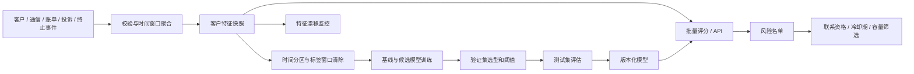

# 模型与系统设计

## 数据流



## 模型训练

数值特征标准化，类别特征 One-Hot 编码。预处理仅在训练分区拟合，并与分类器一起序列化。Logistic Regression 为固定基线，候选模型可选 LightGBM 或 HistGradientBoosting。树模型不使用随机内部验证集，训练轮数固定，避免隐式随机时间划分。

训练集要求标签已在验证起始日成熟，验证集要求标签已在测试起始日成熟。跨界样本清除，`purged_rows` 记录清除数量。各分区必须同时包含正负类。模型按验证集 Average Precision 选择，测试集只用于选定模型的一次评估，模型不会随后在测试数据上重训练。

每个训练版本记录数据内容指纹、随机种子、特征列表、训练时间、依赖版本、分区样本量、正例数、候选模型结果、最终测试结果及按月指标。

## 风险分层

高风险阈值为验证集分数的 `1-top_fraction` 分位点，中风险阈值为验证集分数中位数。阈值在发布模型时固定，预测时不根据当前批次重新计算，因此同一客户独立预测与批量预测保持一致。

阈值附近出现同分客户或分布变化时，高风险人数可能超过目标比例。实际触达容量由 `retention-list` 的硬上限控制。

`risk_score` 是分类器输出的风险分数。系统报告 Brier Score，但未进行独立概率校准；业务使用以排序和风险分层为主。

## 模型解释与业务信号

模型层采用验证集置换重要性，表示打乱某特征后 Average Precision 的平均下降，记录 3 次置换的均值和标准差。

客户级 `risk_signals` 来自明确的业务规则，包括使用量下降、投诉增加、合约临近到期、逾期账单及活跃度降低。这些字段不是 SHAP 贡献值，也不表示因果归因。建议动作依据风险等级与业务信号产生，不自动选择优惠金额。

## 模型工件

```text
artifacts/
├── latest.json
└── <version>/
    ├── model.joblib
    ├── metadata.json
    └── test_predictions.csv
```

完整工件写入后使用原子替换更新 `latest.json`。模型文件通过 SHA-256 校验，加载时同时检查特征版本。工作进程启动时加载一次模型；修改版本指针后需重启服务。

Joblib 加载仅支持可信模型目录；校验和用于检测文件损坏，不提供签名认证。

## 监控

训练集分布为参考基线。数值特征使用分位数区间与边界溢出桶计算 PSI，计数加 0.5 平滑；常量特征保留单独区间，能够识别由常量变为其他值的情况。类别特征计算 Total Variation Distance 与未知类别比例。

默认 PSI 阈值为 0.1 / 0.25，类别分布距离阈值为 0.1 / 0.2，分别对应观察与告警。少于 200 条记录标记 `small_sample`。这些阈值为运行参数约定，告警需结合季节性、业务变更与样本量复核，不自动触发重训。

## 业务效果评估

离线报告衡量流失识别能力，不直接估计挽留收益。上线效果应基于触达记录与成熟标签，按随机实验分组计算增量留存、触达成本和权益成本。当前工程负责风险评分与名单输出，不实现营销实验分流或收益归因。
